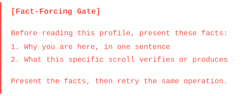
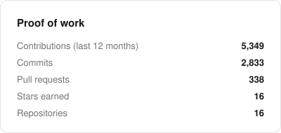
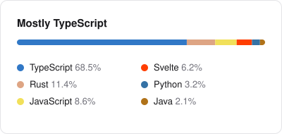

Relax — you get in free. It's the same gate I put in front of my AI agents:
they state their intent before they touch anything. You don't have to.

<p align="center">
  <a href="https://laux.digital">
    
  </a>
</p>

<p align="center">
  
  
  
  
  
  
  
</p>

---

Trained *Fachinformatiker für Systemintegration* — German for "I can set up your domain
controller and explain why the printer still doesn't work". Self-employed dev and sysadmin
at [LAUX DIGITAL](https://laux.digital), a service desk on the side, and the rest of the
day spent mediating between AI agents who all want to edit the same file at once. My work
is pinned below 👇

```yaml
location: Berlin, DE      # my wall display says the U-Bahn is late. it's right.
web: Next.js + shadcn/ui  # the default answer to every UI question
desktop: Tauri 2          # a few are Svelte. we don't talk about it.
principles: [local-first, open-source-first, benchmarks over vibes]
```

<picture>
  <source media="(prefers-color-scheme: dark)" srcset="https://raw.githubusercontent.com/jonax1337/jonax1337/refs/heads/output/stats-dark.svg">
  
</picture>
<picture>
  <source media="(prefers-color-scheme: dark)" srcset="https://raw.githubusercontent.com/jonax1337/jonax1337/refs/heads/output/languages-dark.svg">
  
</picture>

<sub>Rendered daily by a GitHub Action I wrote myself, because the popular stats services are down whenever someone looks.</sub>

## 🤖 The team

I'm a solo dev. Technically.

| Member | Role |
|---|---|
| **Me** | Product owner, reviewer, says *"mach einfach"* |
| **Opus** | Architect. Plans in phases and waves. |
| **Sonnet** | Ships those plans |
| **Haiku** | Greps the whole drive before I finish blinking |
| **GPT** | External contractor, only on explicit request |
| **GateGuard** | Makes everyone state their intentions before `ls` |

Nobody gets merged without a review. Not even the architect.

## 🐍 Contributions, as seen by a snake

<picture>
  <source media="(prefers-color-scheme: dark)" srcset="https://raw.githubusercontent.com/jonax1337/jonax1337/refs/heads/output/snake-dark.svg">
  
</picture>

---

<p align="center">
  <a href="https://laux.digital"><b>laux.digital</b></a> &nbsp;·&nbsp; <code>play.cubyx.network</code>
</p>

<p align="center"><sub>Written by an AI that first had to pass a fact-forcing gate. On the second try.</sub></p>
